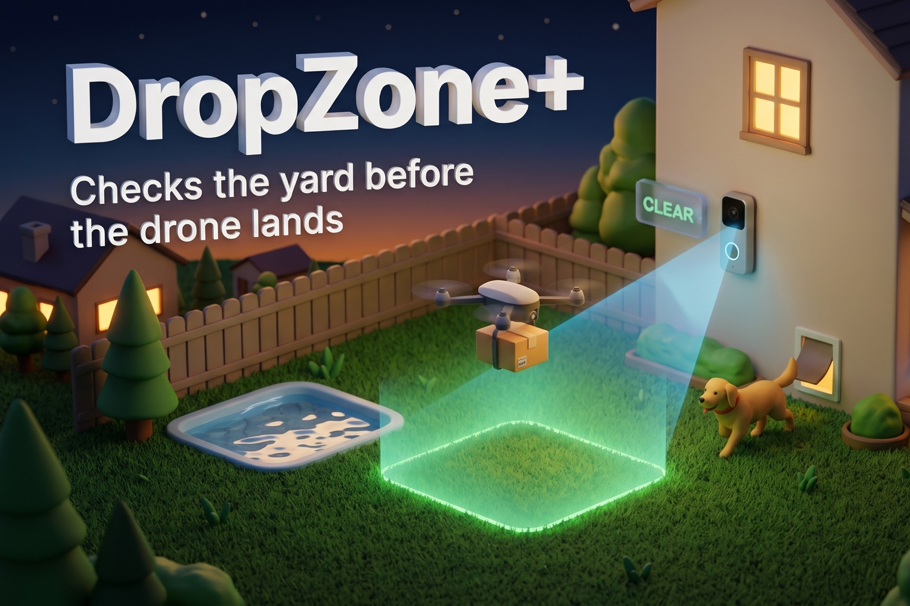
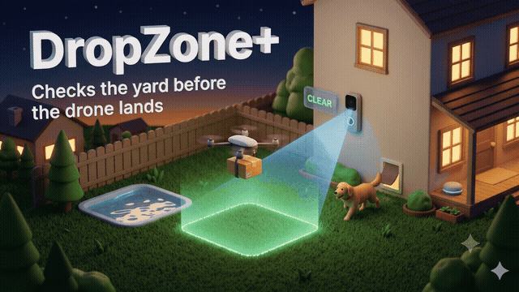
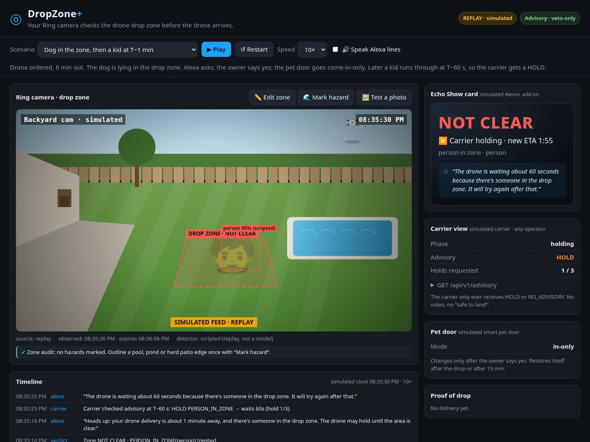
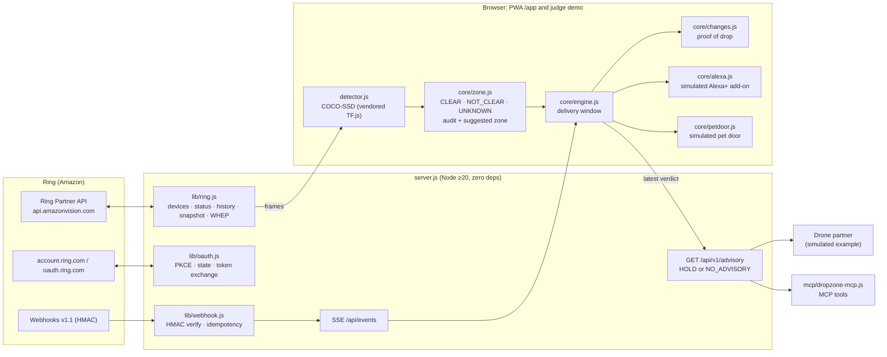

# DropZone+

**Your Ring camera checks the drone drop zone before the drone arrives.**
Ring sees the zone, Alexa tells the household (simulated Alexa+ add-on), a smart pet door can fix the problem with the owner's yes (simulated), and the drone carrier gets a HOLD signal. The carrier never receives video and never receives a "safe to land".



| | |
|---|---|
| 📱 **App (installable PWA)** | https://saurabh4269.github.io/dropzone-plus/app/ |
| 🧪 **Interactive judge demo** (replay, no login, no token) | https://saurabh4269.github.io/dropzone-plus/demo.html |
| 🌐 **Website** | https://saurabh4269.github.io/dropzone-plus/ |
| 🎬 **Demo video** | https://vimeo.com/1238833557 |
| 🧾 **Friction log** | [FRICTION.md](FRICTION.md) |
| 🧰 **Open-source companion** (Ring Partner API mock + signed webhook simulator) | https://github.com/saurabh4269/ring-partner-sandbox |
| 🔌 **Where we call the Ring API** | [table below](#how-the-ring-api-is-used) |

Built for the Amazon Developer Hackathon 2026, **Ring track** ("Ring meets Alexa and other connected devices").



*Concept animation (AI-generated illustration, not product footage). The product screens below are real.*



---

## Why

Drone delivery is moving from pilots to everyday use. Amazon Prime Air is expanding across the US, and Wing with Walmart plans 270+ locations. Each delivery needs a clear patch of yard roughly 10×10 ft, and nobody checks that patch before the drone shows up:

- Amazon asks customers to keep "people, pets, vehicles, and objects taller than 5 feet … at least 10 feet away from the selected delivery point" ([Amazon drone FAQ](https://www.amazon.com/gp/help/customer/display.html?nodeId=T3jxhuvPfQ629BOIL4)).
- If anyone runs through the zone, the drone aborts and the item goes by ground instead ([CT Insider](https://www.ctinsider.com/business/article/amazon-drone-delivery-north-haven-ct-faa-22264288.php)). A Phoenix customer's advice to others: *"If your dogs are in the backyard, bring them in"* ([Business Insider](https://www.businessinsider.com/amazon-drone-deliveries-fun-convenient-phoenix-2026-8)).
- Packages have ended up in pools and ponds ([The Verge](https://www.theverge.com/tech/982808/amazon-prime-air-drones-packages-pools-ponds), [AZFamily](https://www.azfamily.com/2025/08/01/caught-camera-amazon-drone-mishap-sends-package-plunging-into-avondale-pool/)).
- Drop points are chosen remotely from maps, and the drone sees the spot for a few seconds from about 13 ft up ([Prime Air technology](https://www.primeair.amazon/technology)).

A Ring camera has watched that same patch of ground for months. It knows the dog is out right now, that a patio umbrella appeared yesterday, and where the pool is. DropZone+ uses that knowledge **before** the drone arrives, at the point where the household can still do something about it.

## What it does

| Moment | What happens |
|---|---|
| **Set-up (once)** | Draw your drop zone on a Ring frame. Mark the pool, pond or hard patio edge. The **zone audit** warns when a hazard is within downwash range ("Pool is ~4 ft from the drop point; move the zone"). |
| **Drone inbound (T−8 min → T)** | DropZone+ checks the zone on Ring frames and returns **CLEAR / NOT_CLEAR / UNKNOWN**. Each verdict carries `observed_at` and expires after 90 s. **Alexa (simulated Alexa+ add-on)** tells the household: *"Your drone delivery is about 8 minutes away, and there's a dog in the drop zone. Want me to set the pet door to come-in-only until the drone has left?"* Only after the owner says **yes** does the **smart pet door (simulated)** change mode, and it restores itself afterwards. |
| **T−60 s** | The **carrier (simulated, operator-agnostic)** checks the advisory. It gets back either **HOLD** (with reason codes such as `PERSON_IN_ZONE`) or **NO_ADVISORY**. Holds are capped at 3, so a homeowner can't block a delivery forever. |
| **After the drop** | A Ring frame becomes a **proof-of-drop receipt**: inside the zone, outside the zone, next to the pool, or "not confirmed". Alexa says where the box ended up. |

Three replay scenarios show the whole flow: **dog in the zone, then a kid at T−1 min** (consent, pet door, HOLD, drop), **camera can't see** (UNKNOWN is never shown as CLEAR), and **pool next to the drop point** (audit warning, then a receipt showing the box by the pool).

## The app (PWA)

The homeowner app lives at [`/app/`](https://saurabh4269.github.io/dropzone-plus/app/). It's an installable PWA (manifest, icons, offline shell via a service worker) designed for a phone at 390 px, with a bottom tab bar and large tap targets. It follows the system dark/light theme.

| Step | What the user does | Grounded in |
|---|---|---|
| **Welcome** | Three-line value pitch. "What is DropZone+?" links to the website. | Ring UX design guide: skippable first-visit tutorial, plain language |
| **Connect Ring** | **Link Ring account** (Partner-Initiated OAuth 2.0), or **Ring Developer Playground token**, or **Try a demo home** (simulated). Linking is explained *before* any redirect, and a confirmation screen follows. | Ring docs: Partner-Initiated OAuth 2.0 (PKCE S256, `state`, scope `ava.v1:read`, token exchange, `PATCH /v1/accounts/me/app-integrations {status: completed}`), [`lib/oauth.js`](lib/oauth.js). Ring calls are server-to-server, because the docs say browsers are blocked by CORS. |
| **Pick a camera** | Cameras are listed by their user-assigned name with an online/offline dot. Offline cameras are shown dimmed with an explanation. The empty state points to the Ring app. | UX guide: "Displaying connected Ring devices" (never show raw IDs, don't hide offline devices) |
| **Permissions** | Phone notifications, the Alexa heads-up (simulated Alexa+ add-on) and the smart pet door (simulated). | |
| **Mark the drop spot** | Drag the four corners of the zone on a live camera snapshot (or drag the whole zone). Name it ("Back lawn" presets) and describe it in words ("left of the shed, away from the pool"). Mark a pool or hazard, see the audit, and accept a suggested safer spot. Save, and add more zones later with one as the default, like saved addresses in a delivery app. | `public/core/zone.js` audit and suggestion |
| **Home** | Next drone: live CLEAR / NOT CLEAR / UNKNOWN hero, ETA, Alexa line, a one-tap Yes/Not now for the pet door, and HOLD state. Camera tile with **Check now** and **Live view** (WHEP with a Ring token, simulated in the demo). | Engine, advisory, change detection |
| **Deliveries** | History with a proof-of-drop photo, where the box landed (before/after change detection) and how many holds were requested. | `public/core/changes.js` |
| **Partners** | Link drone delivery partners. These are **fictional example partners, labelled simulated**. Each has a "learn more" sheet listing exactly what they get (HOLD / NO_ADVISORY plus reason codes and validity) and what they never get (video, photos, identities, any "safe to land"). Pick which zone each partner uses, optionally share your zone description as drop instructions, and unlink. | Advisory contract |
| **Settings** | Ring connection (change camera, disconnect), notification and helper toggles, theme, plain-language privacy, **delete all my data**, replay the tour, links to the website and the judge demo. | UX guide: data deletion in-app, notification controls |

Data stays on the device (`localStorage`). On static hosting (GitHub Pages) there's no backend, so the app offers the demo home. Run `npm start` locally to use a Playground token or, with partner credentials, real account linking.

## Safety and policy design

This design follows the Ring Program Requirements.

- **Veto-only (Program Requirements 2.8).** The carrier endpoint can only return `HOLD` or `NO_ADVISORY`, and `authorises_drop` is always `false`. CLEAR and UNKNOWN both map to `NO_ADVISORY`, so if DropZone+ is down, slow or unsure, the carrier does exactly what it does today. The aircraft's own detect-and-avoid always stays authoritative. See [`public/core/advisory.js`](public/core/advisory.js) and the tests in [`test/core.test.js`](test/core.test.js).
- **UNKNOWN is a first-class answer.** If the frame is unreadable (offline, end-to-end encrypted, Ring returns an error), too old (>120 s), or the zone isn't defined, the result is UNKNOWN, never CLEAR. Verdicts expire to UNKNOWN after 90 s.
- **It watches your own yard, not the carrier (2.4).** It's carrier-agnostic and doesn't monitor any Amazon service's availability or performance.
- **Labels only, no identity.** The output says "person", "dog" or "vehicle". There's no face matching, no tracking across locations and no plates. The carrier gets only reason codes, never images.
- **Owner consent before any device acts.** The pet door refuses to change without an explicit `ownerConsent === true`. It restores itself after the drop, or after 15 minutes if it never hears about one.
- **Data minimisation.** In the browser path, frames are analysed locally (TensorFlow.js) and never leave the device. The server keeps only the latest verdict in memory.

## How the Ring API is used

The **Ring Partner API** (`https://api.amazonvision.com`, JSON:API) is imported and called at runtime by the server whenever a Ring token is present: from the Playground, from Partner-Initiated OAuth, or from `RING_ACCESS_TOKEN`. The docs require server-to-server calls (browsers are blocked by CORS), so the web app and PWA go through `server.js`. The client [`lib/ring.js`](lib/ring.js) has no SDK dependency, and every request sends the documented `User-Agent` and `Hardware_Id` headers.

| What | Ring endpoint | Code that calls it | Triggered by |
|---|---|---|---|
| Account linking (OAuth 2.0 + PKCE) | `GET account.ring.com/account/integrations/partner-link/authorize`, `POST oauth.ring.com/oauth/token` | [`lib/oauth.js`](lib/oauth.js) `authorizeUrl()`, `handleCallback()` | `GET /auth/ring/start`, `GET /auth/ring/callback` in [`server.js`](server.js) |
| Finalise / remove the integration | `PATCH` / `DELETE /v1/accounts/me/app-integrations` | `ring.completeIntegration()`, `ring.removeIntegration()` in [`lib/ring.js`](lib/ring.js) | OAuth callback; Settings → Disconnect |
| Token check | `GET /v1/users/me` | `ring.me()` | `POST /api/ring/token` (Playground token onboarding), discovery |
| Camera discovery | `GET /v1/devices?include=status,capabilities` | `ring.devices()`, `pickDevice()`, `summarizeDevice()` (follows JSON:API `relationships` → `included`) | `GET /api/ring/devices` (PWA camera picker), `GET /api/ring/discover` |
| Status / capabilities | `GET /v1/devices/{id}/status`, `/capabilities` | `ring.status()`, `ring.capabilities()` | `GET /api/ring/discover` |
| Event history | `GET /v1/history/devices/{id}/events?event_types=…` | `ring.history()` | `GET /api/ring/discover` |
| **Snapshots** for zone checks and proof of drop | `POST /v1/devices/{id}/media/image/download` (`latest_in_range`) → 303 → signed `GET /v1/download` | `ring.snapshot()` (manual redirect; the bearer token is not sent to the download host) | `GET /api/ring/snapshot?device=` ← PWA Check now and delivery window, demo "Check zone now", proof of drop |
| **Live view** (WebRTC/WHEP, recvonly) | `POST /v1/devices/{id}/media/streaming/whep/sessions`, `DELETE …/sessions/{id}` | `ring.whepStart()`, `ring.whepStop()` | `POST`/`DELETE /api/ring/whep` ← PWA Live view, demo Live view |
| **Webhooks** (v1.1, `X-Signature: sha256=<hex>`) | Ring → `POST /webhooks/ring` | `verify()` and `firstDelivery()` in [`lib/webhook.js`](lib/webhook.js); handler in `server.js` | A motion event re-checks the zone while a drone is inbound (SSE `/api/events`) |

Runtime proof without a Playground token: `test/live.integration.test.js` boots `server.js` against [ring-partner-sandbox](https://github.com/saurabh4269/ring-partner-sandbox) and exercises discovery, snapshot (303), signed webhooks and SSE. `npm run ring:probe` does the same against the real API with your token.

The Playground can't send webhooks, so [`scripts/simulate-events.js`](scripts/simulate-events.js) sends **Ring-shaped, HMAC-signed, labelled-simulated** events through the same verifier. Amazon said on the forum that a self-written simulator is fine ([thread 45511](https://amazonappdev2026.devpost.com/forum_topics/45511-ring-track-does-simulator-include-one-i-wrote-myself)).

`npm run ring:probe` exercises every endpoint above and prints what came back.

## What's real and what's simulated

| Piece | Status |
|---|---|
| Zone geometry, CLEAR/NOT_CLEAR/UNKNOWN logic, expiry, zone audit | **Real** (`public/core/zone.js`, unit-tested) |
| Veto-only carrier advisory contract (`GET /api/v1/advisory`) | **Real** API; the **carrier that consumes it is simulated** |
| Object detection on Ring snapshots, Ring live frames, and photos you upload | **Real**: TensorFlow.js COCO-SSD running in the browser, vendored in `public/vendor/` (no CDN needed) |
| Proof of drop (where the box landed) | **Real** before/after change detection (`public/core/changes.js`); in the demo it runs on simulated frames |
| Ring account linking (Partner-Initiated OAuth 2.0) | **Real code per the docs, never run against Ring**: needs partner credentials we don't have. Unit-tested with a fake token endpoint |
| PWA: onboarding, saved drop zones, history, settings, offline shell | **Real** (data in this browser's `localStorage`) |
| PWA "demo home" camera (Backyard Cam, Front Door offline) | **Simulated**, labelled "Demo home · simulated" on every screen |
| Delivery partners (SkyHop Air, ParcelWing, Neighborly Drone Co-op) | **Fictional example partners, simulated**; no real company is integrated or depicted |
| Hero image and concept GIF at the top of this README | AI-generated illustrations, not product footage |
| Ring Partner API calls (discovery, history, snapshot, WHEP) | **Real** in LIVE mode (needs a Playground token) |
| Ring webhooks | Real HMAC verification; **events simulated** (the Playground can't send webhooks) |
| Replay yard, actors and their "detections" | **Simulated**: a drawn scene with **scripted** boxes, labelled "SIMULATED FEED · REPLAY" and "(scripted)" on screen |
| Alexa | **Simulated Alexa+ add-on**: utterances and consent prompts, spoken with browser TTS. Also exposed as an **MCP server** ([`mcp/dropzone-mcp.js`](mcp/dropzone-mcp.js)), the interface Alexa+ add-ons use. There is no public Alexa+ access for this hackathon |
| Smart pet door | **Simulated** adapter (modelled on Alexa-compatible doors such as Wayzn/Pawport) |
| Amazon Bedrock (Nova) frame description | **Optional**, off by default; exercised up to AWS auth, not yet run with real credentials ([`lib/bedrock.js`](lib/bedrock.js)) |

Nothing here is affiliated with, endorsed by, or connected to any drone operator.

## Architecture



The `public/core/*` modules are pure ES modules shared by the browser, the server and the tests. That's why the same logic runs as a static site (GitHub Pages: PWA demo home and replay demo) and against live Ring.

## Run it

Requirements: Node ≥ 20. There are no runtime dependencies (`@aws-sdk/client-bedrock-runtime` is optional).

```bash
git clone https://github.com/saurabh4269/dropzone-plus && cd dropzone-plus
npm test                 # 36 tests: zone logic, veto-only advisory, consent, every replay scenario, change detection,
                         #   OAuth/PKCE, HMAC webhooks, and LIVE-mode integration against ring-partner-sandbox (if present)
npm run e2e              # headless Chrome: landing, demo scenarios (needs local Chrome)
npm run e2e:app          # headless Chrome at 390x844: full PWA journey, onboarding to proof of drop
npm start                # http://localhost:8787  → REPLAY mode (no token needed)
```

**CI.** [`ci/ci.yml`](ci/ci.yml) runs `npm test` on Node 20 and 22 (with ring-partner-sandbox installed, so the LIVE-mode integration tests run) plus both browser end-to-end suites. Our deploy token can't push files under `.github/workflows`, so the workflow lives in `ci/`; `scripts/enable-ci.sh` installs it once a maintainer runs `gh auth refresh -s workflow`. Every commit before submission was tested locally with the same commands.

**Ring Developer Playground end to end, one command:**

```bash
export RING_ACCESS_TOKEN=...   # developer.amazon.com/ring/console/playground (lasts ~30 min)
npm run playground             # prints PASS/FAIL per step, screenshots in /tmp/dropzone-playground-*.png
```

It calls the Ring Partner API directly (users/me, devices, status, capabilities, history, snapshot via the 303 flow). It then drives the **real PWA** in headless Chrome against `server.js`: Check now (Ring snapshot → verdict), **Live view over WHEP** (recvonly, the Playground's simulated DoorbellPro), **COCO-SSD detection on the live frame**, the carrier advisory, and the WHEP session `DELETE`. To dry-run without a token, point it at the mock (`RING_API_BASE=http://127.0.0.1:8686 RING_ACCESS_TOKEN=sandbox-token`); WHEP is then reported as SKIP because the mock can't stream video. Auth supports both modes of the official starter: `RING_ACCESS_TOKEN`, or `RING_REFRESH_TOKEN` + `RING_CLIENT_ID` + `RING_CLIENT_SECRET`.

**LIVE mode with the Ring Developer Playground:**

```bash
export RING_ACCESS_TOKEN=...       # developer.amazon.com/ring/console/playground (lasts ~30 min, no refresh)
npm run ring:probe                 # optional: check every endpoint and save a snapshot to /tmp
npm start                          # UI switches to LIVE: Discover → Check zone now → Live view → Simulate drone order
RING_WEBHOOK_SECRET=dev-secret npm run sim -- human   # (other terminal) simulated signed webhook → re-check
```

The server listens on `127.0.0.1` by default (set `HOST=0.0.0.0` deliberately; in LIVE mode it proxies your camera). No token? Run LIVE mode against our open-source mock of the Ring Partner API, [ring-partner-sandbox](https://github.com/saurabh4269/ring-partner-sandbox): `npx github:saurabh4269/ring-partner-sandbox serve` (or clone it and run `node bin/ring-sandbox.js serve`), then `RING_API_BASE=http://localhost:8686 RING_ACCESS_TOKEN=sandbox-token npm start`. The badge then reads "LIVE · mock Ring API" so it can't be mistaken for real Ring data. Add `?replay` to the URL to force replay mode while a token is set. `?scenario=pool&seek=200` jumps into a scenario. `?photo=<image-url>` runs real detection on any CORS-readable image.

**MCP (simulated Alexa+ add-on surface):**

```json
{ "mcpServers": { "dropzone-plus": { "command": "node", "args": ["mcp/dropzone-mcp.js"], "env": { "DROPZONE_URL": "http://localhost:8787" } } } }
```

Tools: `get_dropzone_status`, `get_carrier_advisory`.

**Optional Amazon Bedrock:** `npm i @aws-sdk/client-bedrock-runtime`, set AWS credentials, then run `DZ_BEDROCK=1 AWS_REGION=us-east-1 npm start`. `POST /api/vision/bedrock` sends a frame to Amazon Nova Lite through the Converse API and returns detections in the same shape `zone.js` scores.

### Advisory contract (`GET /api/v1/advisory`)

```json
{
  "schema": "dropzone-plus/advisory@1",
  "advice": "HOLD",
  "authorises_drop": false,
  "reason_codes": ["PERSON_IN_ZONE"],
  "hold_seconds": 60,
  "zone_status": "NOT_CLEAR",
  "observed_at": "2026-10-23T15:01:45.000Z",
  "valid_until": "2026-10-23T15:03:15.000Z",
  "delivery_ref": "SIM-OLCKRQ",
  "disclaimer": "Advisory only. Can request a delay, never authorises a drop. …"
}
```

## Limitations and next steps

- **No carrier integration exists.** The carrier side is a simulation of a contract we'd propose to operators. The household-facing value (bring the dog in, fix your zone, proof of where the box landed) doesn't depend on any carrier.
- **Camera coverage.** A front doorbell sees a driveway or front-yard drop zone (Wing offers driveway drops). Backyard zones need a backyard camera.
- **Vision is a general detector (COCO-SSD).** Hazards like water are marked once by the owner rather than inferred from pixels. Proof of drop doesn't need a "package" class: it compares frames from before and after the drop (change detection near the zone).
- **Account linking needs Ring partner credentials.** The Partner-Initiated OAuth flow is implemented and unit-tested against the documented parameters, but hackathon entrants don't get a `client_id`, so it hasn't run against Ring. The Playground token and the demo home are the working paths.
- **Playground limits:** one simulated device, a 30-minute token with no refresh, and no webhooks. See [FRICTION.md](FRICTION.md).

## References we used

- Ring Partner API documentation (API reference, Partner-Initiated OAuth 2.0, App Integrations, WHEP, image snapshots, webhooks): https://developer.amazon.com/docs/ring/api-documentation.html
- Ring "Your App Design Guide for Ring Customer Experiences": https://developer.amazon.com/docs/ring/ux-design-guide.html (onboarding, device display, data deletion checklist)
- Ring Program Requirements and Content Policy (2.4, 2.8, data minimisation)
- Official starter **AmazonAppDev/ring-api-helloworld** (auth modes, WHEP proxy pattern, webhook route): https://github.com/AmazonAppDev/ring-api-helloworld
- Hackathon forum answers on Playground replay mode, self-written simulators and "simulated Alexa+ add-on" wording (threads 45462, 45511, 45541)

## Licence and credits

MIT (see [LICENSE](LICENSE)). In-browser detection uses [TensorFlow.js](https://github.com/tensorflow/tfjs) and the [COCO-SSD model](https://github.com/tensorflow/tfjs-models/tree/master/coco-ssd) (Apache-2.0), loaded from jsDelivr at runtime. The replay yard is drawn in code; no third-party footage is included.
