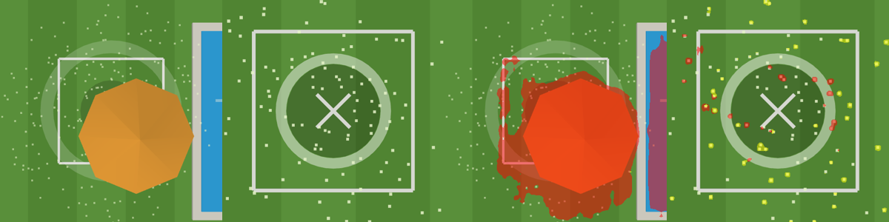

# Drone-side vision vs a fixed home camera

**Drone-side vision (OpenLander, MDPI Drones 8(1):21) vs fixed home camera (DropZone+): complementary, not rivals.**

The [3D simulation](https://saurabh4269.github.io/dropzone-plus/sim/) (`public/sim/`) puts both viewpoints in the same simulated backyard so the trade-offs are visible. Everything in it is simulated: scripted actors, a "ground-truth detector" that projects 3D bounding boxes into each camera (no occlusion, no misses), and a simulated carrier. The zone verdict (`evaluateZone`), the carrier advisory (`buildAdvisory`) and the proof-of-drop (`findNewObject` on rendered 160×90 Ring frames) are the real modules from `public/core/`.

## The two approaches

**OpenLander** ([github.com/stephansturges/OpenLander](https://github.com/stephansturges/OpenLander), MIT, by Stephan Sturges). Semantic segmentation on the drone's own camera to find safe landing/delivery areas. The README describes a green mask for "safe", a yellow mask for "obstacle / human", and no mask for "not safe"; the free version outputs three classes (obstacle, human, safe). It runs on Luxonis OAK devices (DepthAI, `.blob` models). An ONNX version is published in the Hugging Face Space [StephanST/OpenLanderONNXonline](https://huggingface.co/spaces/StephanST/OpenLanderONNXonline) (DeepLabV3+ with a MobileNetV2 backbone at 416 px; red = obstacle, yellow = human, no colour = clear).

**MDPI Drones 2024, 8(1), 21**: Alsawy, Moss, Hicks, McKeever, *"An Image Processing Approach for Real-Time Safety Assessment of Autonomous Drone Delivery"* (TU Dublin with Manna Drone Delivery), [doi:10.3390/drones8010021](https://doi.org/10.3390/drones8010021). From the abstract: an image-processing-based classification approach for the dropping stage at a predefined destination, using live streaming from a single onboard camera plus GPS. It has two stages, image segmentation then classification, and takes camera parameters, light parameters, dropping-zone dimensions and the drone's height into account. The authors report a fast method with reliable accuracy based on low-order calculations. (The mdpi.com page returned HTTP 403 to our fetch. The abstract was read from the Crossref record for the DOI, so we describe only what the abstract says, not the paper's detailed results.)

**DropZone+** (this repo). A fixed Ring camera that has watched the same patch of lawn for months checks the owner-drawn drop zone *before* the drone arrives. It returns CLEAR / NOT_CLEAR / UNKNOWN and gives the carrier only a veto-only advisory: HOLD or NO_ADVISORY, never "safe".

## Comparison

| | Drone-side vision (OpenLander, MDPI Drones 8(1):21) | Fixed home camera (DropZone+) |
|---|---|---|
| Viewpoint | Onboard, looking down from the final approach (~13 ft at drop) | Fixed on the house, 2.4 m up, wide lens, always on |
| When it sees the zone | Only for the last seconds before the drop | Continuously, minutes before the drone arrives |
| What it can do about a problem | Abort or delay the drop | Tell the household early (Alexa, simulated), let them fix it (pet door, simulated), ask the carrier to HOLD |
| Dog walks into the zone 30 s before arrival (sim scenario 1) | Sees it at the last moment → abort, wasted trip | Sees it at once → Alexa asks, owner says yes, pet door → HOLD → drop happens |
| Pool just outside the drop point (sim scenario 2) | At 13 ft the pool is outside a 60° camera's footprint (≈ 4.6 m wide), so it can't know | Owner marked the pool once; zone audit warns; downwash pushes the box → receipt says "next to the pool" |
| Stale survey: patio umbrella put up after the drop point was mapped (sim scenario 3) | Sees it on arrival → abort | Sees it now → HOLD (max 3); the household can move it before the drone even launches |
| Last-second events (final ~2 s) | **Wins**: it is looking at exactly that moment | Its advisory may already have been sent |
| Areas the home camera can't see; homes with no camera | **Wins**: needs nothing from the home | Needs a camera that covers the zone |
| Hardware | Drone payload (e.g. Luxonis OAK for OpenLander) | Camera the household already owns |
| Privacy | Drone imagery of the yard | Video stays with the household; carrier gets two words and reason codes |
| Authority | **Authoritative**: the aircraft's own sensors decide | **Veto-only**: can ask for a delay, never authorises a drop |

## Our stance

DropZone+ is veto-only. It can only say HOLD or NO_ADVISORY (`authorises_drop: false` is hard-coded). If it's down, slow or unsure, the carrier sees NO_ADVISORY and flies exactly as it does today. The drone's own sensors, including drone-side vision like OpenLander or the MDPI approach, stay authoritative. The two are complementary. The home camera gives early warning and context the drone can't have (time, owner-marked hazards, the household in the loop). The drone camera covers the last seconds and every home without a camera. In the simulation's umbrella scenario, the hold budget runs out and the drone-side check makes the final call (abort). That is the intended division of labour.

## OpenLander on the simulated drone view

We ran it. We downloaded the ONNX models from the Hugging Face Space (`20230608_onnx_416_mbnv2_dl3/end2end.onnx`, which the Space labels "embedded model better trained: DeeplabV3+, MobilenetV2, 416px", and the root `end2end.onnx`). We ran them with `onnxruntime` 1.31 (CPU, Python) on 540×540 drone-camera frames rendered by the sim, resized to 416×416. We used the same preprocessing as the Space's `app.py` (RGB, /255, NCHW) and its class mapping (0 = obstacle, 1 = clear, 2 = human).

*Left two: rendered drone views (umbrella scenario during descent; dog-kid scenario at 13 ft, clear). Right two: OpenLander output (red = obstacle, yellow = human).*

| Frame (rendered, simulated) | obstacle | clear | human |
|---|---|---|---|
| Umbrella over the zone (during descent; pool at the edge of view) | 38.3 % | 61.7 % | 0 % |
| Clear zone at 13 ft (downwash particles visible) | 1.0 % | 97.5 % | 1.5 % |
| Pool-gust scenario, clear zone at 13 ft | 0 % | 96.5 % | 3.5 % |

The model flags the umbrella (and the pool, where it is in view) as obstacle and leaves the clear lawn clear. Our flat-shaded downwash particles produce small speckles of false "human"/"obstacle". This is a low-poly synthetic render, far from the model's training distribution, so treat the numbers as a smoke test, not an evaluation. We did not run the Luxonis `.blob` models: they target OAK hardware.
